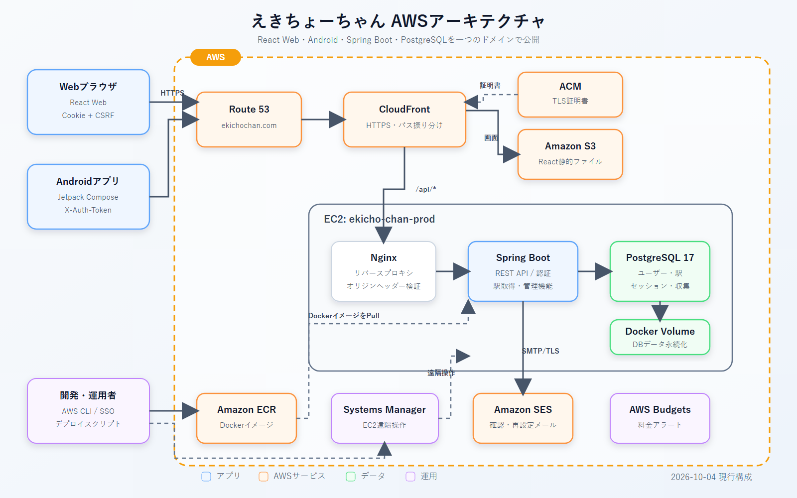

# えきちょーちゃん

駅をガチャや現在地で獲得し、ユーザーごとのコレクションとして楽しむWeb・Androidアプリケーションです。

Spring BootとPostgreSQLで共通APIを構築し、React WebとJetpack ComposeのAndroidアプリから利用します。ユーザー登録、メール確認、セッション認証、ロール制御、Docker、AWSへのデプロイまでを実装したポートフォリオです。



## 主な機能

- ガチャによるえきちょーちゃん取得
- 位置情報を使用したえきちょーちゃん取得
- 取得したえきちょーちゃんの閲覧
- ユーザー登録・認証（通常モード。公開デモでは無効）

## 技術スタック

| 領域 | 技術 |
|---|---|
| Backend | Java 25, Spring Boot 4, Spring Security, Spring Session JDBC, Spring Data JPA, Flyway |
| Web | TypeScript, React 18, Material UI, React Router |
| Android | Kotlin, Jetpack Compose, Material 3, Retrofit, OkHttp, Coroutines |
| Database | PostgreSQL 17 |
| Local infrastructure | Docker Compose, Nginx, Mailpit |
| AWS | CloudFront, S3, EC2, ECR, Route 53, ACM, SES, Systems Manager |

## リポジトリ構成

```text
ekicho-chan-android/   Androidアプリ
ekicho-chan-server/    Spring Boot API
ekicho-chan-client/    React Webアプリ
ekicho-chan-docker/    Docker Compose・Nginx・公開用サンプルDB
docs/                  仕様書・AWS構成図
```

## アーキテクチャの特徴

- CloudFrontをWebとAPIの共通入口とし、通常パスをS3、`/api/*`をEC2へ転送
- EC2でNginx、Spring Boot、PostgreSQLをDocker Compose管理
- WebはCookie + CSRF、Androidはヘッダー認証とし、Spring Session JDBCを共通利用
- 認証済みAPIのアカウントIDはリクエストから受け取らず、Spring Securityの認証主体から取得
- Request / Response DTOとEntityを分離し、外部APIとDBモデルの責務を分離
- Controller、Service、Repositoryに分け、HTTP、業務ロジック、DBアクセスを分離

## ローカル起動

### 必要環境

- Java 25
- Docker Desktop / Docker Compose
- Node.js / npm
- Android Studio（Android版を実行する場合）

### API・DB・Mailpit

```powershell
cd ekicho-chan-docker
Copy-Item .env.example .env
# .envのプレースホルダーをローカル専用値へ変更
docker compose config --quiet
docker compose up -d
docker compose ps
```

- API: `http://127.0.0.1:18080`
- Mailpit: `http://127.0.0.1:8025`

### React

```powershell
cd ekicho-chan-client
npm ci
npm start
```

### Android

`ekicho-chan-android/local.properties`を作成し、エミュレーターからDocker版APIへ接続する場合は次を設定します。

```properties
sdk.dir=C\:\\Users\\YOUR_NAME\\AppData\\Local\\Android\\Sdk
EKICHO_API_BASE_URL=http\://10.0.2.2\:18080/
```

Android Studioで `ekicho-chan-android`を開き、Debug版を実行します。

## テスト

```powershell
cd ekicho-chan-server
.\gradlew.bat test

cd ..\ekicho-chan-android
.\gradlew.bat testDebugUnitTest

cd ..\ekicho-chan-client
npm test -- --watchAll=false
```

## セキュリティ上の配慮

- Argon2によるパスワードハッシュ
- 確認・再設定トークンはダイジェストのみDB保存
- Web更新系APIのCSRF保護
- CORS許可元の明示的な列挙とワイルドカード拒否
- `USER` / `ADMIN`によるサーバー側認可
- 秘密情報の環境変数注入
- NginxでCloudFrontオリジン確認ヘッダーを検証

## 公開用データについて

本リポジトリでは機密情報、署名鍵、DBバックアップ、運用ログ、実ユーザーデータを公開していません。大容量の駅画像データも、再配布条件の確認が必要なため除外しています。

## 現在の課題

- Webの旧取得履歴とAndroidの新コレクションAPIの統合
- Reactの自動テスト拡充
- ログイン連続失敗制御とレート制限
- 本番DBのRDS分離とバックアップ自動化

## License

ライセンスは公開前に決定予定です。現時点で、明示的な許可なくコードや画像を再利用することはできません。
